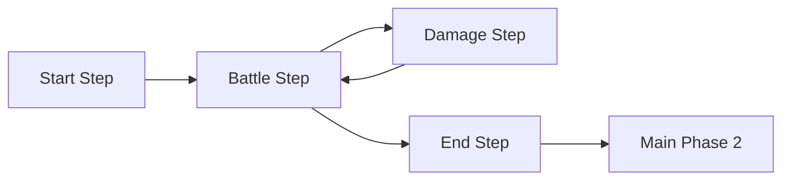

# Shared duel model

Provides immutable two-player duel state and a deterministic command engine.
It handles opening hands, draws, phases, eligible Level 1–4 normal summons,
monster and Spell/Trap sets, position changes, effect-free attacks, battle damage,
destruction, LP defeat, hand-limit discards and deck-out. Card instances reference
the normalized catalog;
explicit gameplay metadata is required rather than guessing binary kind codes.

Battle eligibility and ordinary Spell/Trap placement require explicit opt-in metadata.
There is no renderer, emulator, randomness or general effect engine.
Snapshots expose complete engine information; presentation needs a visibility view.
See the [root quick start](../README.md#quick-start) for build and validation commands.

## Pending decisions

The optional `decisionSequences` constructor argument registers trusted immutable
selection policies. No sequences are enabled by default. `DecisionStep.Card`
selects instances from the acting player's hand or deck using explicit catalog
IDs; `DecisionStep.Position` supplies allowed positions; `EmptyMonsterZone`
offers only unoccupied monster slots. Definitions are copied and validated.
Sequences contain 1–32 steps and can start only in the active player's Main1.

The command/answer flow is:

```text
BeginDecisionSequence(player, configuredSequenceId)
ChooseDecisionCard(player, currentDecisionId, cardInstanceId)
ChooseDecisionPosition(player, currentDecisionId, position)
ChooseDecisionZone(player, currentDecisionId, monsterZone)
```

Read the current `State.PendingDecision` after each accepted answer; its kind,
options, owner and ID define the next legal answer. Not every definition needs
all three kinds. Decision IDs use the revision of the accepted request state.
`State.Revision` advances once per accepted command and never for rejections.
No random IDs or mutable out-of-state decision counters are used.

Before opening a sequence, the engine preflights every step for available
choices. While pending, unrelated commands reject with `DecisionPending`.
Wrong player/ID/kind/option and out-of-order/repeated answers reject with the
same state object, no revision change and no events. Pending request/options,
earlier answers, events and completed results are immutable snapshots.

Accepted answers emit `DecisionAnswered` followed by either `DecisionRequested`
or `DecisionSequenceCompleted`. Completion clears the request and publishes
`State.DecisionResult`. Choosing cards/zones does not move or summon anything,
consume a summon, activate a Spell, or execute an effect.

`DecisionSequence` defaults to `stopAfterCompletion: true`: completion sets
`ResearchSliceComplete`, further gameplay rejects, and `Outcome` remains
unchanged. Construct a new duel to restart that research slice. A trusted
selection-only workflow can explicitly use `false` to resume ordinary commands.
That option must not be used to bypass unsupported card lifecycle behavior.

Both pending card options and completed answers expose full engine information.
A future UI must provide an actor-specific visibility view. These workflows have
synthetic managed tests; they do not establish PSP activation equivalence.

## Experimental Spell activation/resolution

The separate `experimentalSpellEffects` constructor argument explicitly registers
immutable `DeckSpecialSummonSpell` profiles supplied by Effects. It is empty by
default and independent of normal-summon, battle and back-row-setting flags.
Profiles require compatible explicit Spell/Monster metadata; ordinary sequence
commands cannot start a profile's reserved activation decisions.

`ActivateSpell` commits the hand card to a face-up back-row slot and creates a
card decision. Subsequent choices use the same typed decision API. On the final
zone answer, Core revalidates the bound card instances and destination, removes
the selected deck instance, Special Summons it in attack position and appends the
Spell to the graveyard atomically. Normal Summon allowance and unrelated state
remain unchanged. The activation/resolution profile sets the research boundary
after cleanup. The separate lifecycle profile permits phase progression and
explicitly opted-in basic battle. In End Phase it banishes the bound summoned
instance if still on the field, or expires the obligation if battle destroyed it
and it remains in the graveyard, then stops. Other card actions reject atomically.

`SpellTrapFields` is the authoritative immutable view of back-row cards and
face-up state. `SpellTrapZones` remains a compatible card-only projection.
`SetSpellTrap` still places face-down cards. `PendingSpellActivation` binds the
committed Spell and effect while decisions are pending and clears on resolution.

See [Effects](../TagForceSpecial.Effects/README.md) for Emergency Teleport's exact
research scope and PSP comparison limitations.

`DuelPlayerState.Banished` and `PendingEndPhaseBanishments` are copied read-only
collections. The lifecycle profile records source Spell, summoned instance,
zone and due turn; it removes only that field instance and appends it to its
owner's banished zone. Graveyard, hand copies, earlier field copies and Normal
Summon allowance remain unchanged. This is a bounded experiment, with no general
delayed-effect scheduler, shuffle, movement/reset exceptions or next-turn continuation.

## Activation costs and targets: commitment only

`experimentalActivationContracts` registers immutable, default-off
`ActivationContract` profiles. These are distinct from executable Spell effects:
they stop at an `ActivationCommitted` receipt, before resolving effects or
responses. Cost and target availability are checked before moving the source
Spell from hand to a face-up slot.

`ChooseDecisionCard` pays an eligible discard immediately, appending the selected
owned hand instance to graveyard and emitting `ActivationCostPaid`. The source
cannot pay for itself. If a target choice follows, payment remains committed;
invalid answers neither refund nor charge it again. Combined cost/target order
has synthetic tests, not a newly verified native costed-targeting card.

`ChooseDecisionTarget` selects an immutable `PendingDecision.TargetOptions` entry.
The binding records player, slot, card instance and `FieldSpellTrap.PlacementId`.
Engine placements receive deterministic revision-based tokens. Face-up changes
must preserve the token; leaving/re-entering must allocate a new one.
`SpellTrapTarget.IsStillPresent` checks the field at the bound player/slot:
it accepts a face-up change and rejects absence, replacement and a new placement
of the same card. It does not resolve, fizzle or automatically retarget an effect.
The target policy covers the five back-row slots; Field Zone targeting is outside
this research profile.

The committed receipt retains source Spell, paid discard and optional target.
Research then freezes with the source still on the field. No destruction,
negation, refund, cleanup or chain resolution is silently performed. Costs and
targets differ from resolution choices such as Emergency Teleport's deck choice.
Snapshots remain full-information: opponent face-down target identities require
an opaque presentation view before UI integration.

## Bounded chain research

`experimentalChainEffects` adds a separate, default-off opt-in. A matching
`ChainEffectProfile` consumes the committed receipt and opens `State.PendingChain`
instead of freezing. Existing activation-only callers keep their previous behavior.
The supported operations are opposing face-up monster destruction, bound back-row
destruction, and the targeted, previously set four-token response. Registration
validates matching commitment kinds and explicit Spell/Monster metadata.
Profile IDs and decision choices are nonzero catalog identities, without PSP
packed-ID bounds. Engine registration validates catalog membership; source-format
validation stays outside Core.

`PassChainResponse(player, decisionId)` alternates responders. Two consecutive
passes close the response window. `ActivateChainResponse(player, decisionId, zone)`
preserves the source placement and resets passes after commitment. The opponent's
targeted Scapegoat response retains its original two-link restriction.

The separate `experimentalChainResponses` argument registers immutable
`ChainResponseProfile` metadata for previously set responses. It is empty by
default. Supported operations are bound back-row destruction, activation negation
and effect-only negation. Profiles declare response speed, eligible discard IDs,
optional preceding source category and whether negation destroys that source.
Only speed 2/3 responses are accepted; a speed 2 response cannot follow speed 3.
Sources must be face-down and set on an earlier turn. Hand responses, general
timing windows, protection effects and full card legality remain unsupported.

Costs and target choices use the existing decision commands, owned by the
responder rather than necessarily the active turn player. Invalid answers reject
atomically; a paid discard remains paid while a target choice waits. Each receipt
is stored in its chain link; `State.CommittedActivation` retains the initial
activation receipt. A negation response binds the immediately preceding link.

`ResolveNextChainLink(activePlayer, decisionId)` advances one complete link in
reverse order, with no responses during resolution. Both players' commands go
through the same `Execute` entry point, independently of the active turn player
while a response is pending. Wrong player, stale ID, unsupported response and
unrelated commands reject with the same state object and no events. Snapshots,
links, source placements and paid costs remain immutable and deterministic.

The four tokens resolve before Typhoon destroys the bound Scapegoat. Its face-up
change preserves target identity; its later destruction does not remove tokens.
Source cleanup follows the last link and does not duplicate a destroyed source.
Completion freezes the research slice without a duel result or later token play.
Typhoon's missing/replaced target skips destruction, emits `ChainLinkSkipped`
and continues through cleanup without retargeting. Negated links also emit a skip
reason before completing. `ChainLink.Negation` distinguishes effect-only and
activation negation; both suppress the effect, while only the latter sets
`ActivationNegated`. Source destruction is a separate profile policy and checks
the bound source placement. Paid costs stay in graveyard, even if a response is
itself negated. Source cleanup appends each surviving source once and emits
`ChainTrapSentToGraveyard` for Traps. Native array sizes do not impose a managed
chain-length rule; currently supported response/placement rules still apply.

The alternating-pass protocol, revision IDs, explicit resolution stepping, token
instance/zone allocation and event ordering are PC design choices. Local reference
tests compare retained repeated paid/committed, four-token and final state
projections. Native controller analysis corroborates other-player-first offers,
reverse resolution, distinct negation flags and target identity revalidation.
New synthetic interaction tests exercise the interpreted contract, including
negating a negation and destroying a lower link's source without negating it.
Effect-only negation is an engine primitive tested with invented profiles; no
real effect-only card's complete eligibility is advertised. Fresh native
rejection, interruption and negation replays remain required before the roadmap's
stage 6 completion gate can pass.

## Stage 7: event-driven triggers and continuous stats

Register immutable `TriggerEffectProfile` and `ContinuousEffectProfile` instances
through `experimentalTriggerEffects` and `experimentalContinuousEffects`. They
are empty by default and require explicit catalog Monster rules. Multiple effects
on a card and multiple copies of a card are supported. All effect IDs are distinct
from existing activation/response IDs. IDs use the full catalog identity range.
No card text, PSP category codes or per-card timing switches are interpreted.

Supported trigger events are normal summons, Special Summons (including
tokens), flip summons, destruction and supported sends to the graveyard. A field source must be face-up at the
event and still occupy the same placement at the activation boundary. An explicit
`DestroyedSelf` profile instead activates from that exact card in the graveyard;
it may have been face-down before destruction. `GraveyardSelf` also supports
monster discards and destruction via `SentToGraveyard`. Other source locations,
damage-step activation windows and replacement/prevention effects remain unsupported.
Atomic battle's destruction events are collected after its damage/destruction
transition; LP defeat still ends the duel before battle destruction.

`State.EventEffects.PendingTriggers` publishes immutable groups. Use
`ChooseTriggerOrder(player, decisionId, triggerIds)` to order every mandatory
option, or an ordered subset of optional options (empty declines that group).
Groups are turn-player mandatory, other-player mandatory, turn-player optional,
then other-player optional. No fast response is admitted between these groups.
Wrong player, stale IDs, duplicates, unknown IDs and omitted mandatory effects
reject without state changes or events. Ordering is a player choice, independent
of profile registration order, zone order and card ID.

Once the groups are ordered, ordinary `PendingChain` links use the existing
response/pass, reverse-resolution and distinct negation machinery. Registered
set responses can explicitly filter for a Monster source. Monster effect sources
are not Spell activations and are not sent to the graveyard by chain cleanup.
Removing one source does not negate its other committed effects. Effects generated
during a chain are collected and revalidated after all links and cleanup, never
inserted into the resolving chain. Follow-up trigger chains preserve an existing
research stop; triggers raised by ordinary commands resume ordinary gameplay.
Unsupported spell shuffle/lifecycle continuations are not enabled by opting in.

The first reusable trigger operations gain controller LP or add an ATK/DEF delta
to the event monster until entry into the current turn's End Phase. The latter
binds a placement, rechecks it on resolution, persists independently of the source
and expires on End Phase entry or when its subject leaves/becomes face-down.
This precise duration is a PC primitive, not a complete "until end of turn" card
contract. New operations can share the same event/order/chain path.

Continuous profiles add ATK/DEF to self, controller's monsters, opponent's monsters
or all face-up monsters while the source is face-up. Contributions are derived
from current placements after every accepted transition, not accumulated into
printed catalog stats. Copies stack; removing a source removes only its
contributions. `State.EventEffects` publishes applied modifiers, effective stats
and temporary durations; `GetMonsterStatistics(player, zone)` queries the current
placement. Additive deltas are summed before clamping to the managed nonnegative
`int` range; unresolved printed values remain unresolved. LP gains saturate at
`int.MaxValue`. These are managed numeric policies, unrelated to PSP encoding.

Basic battle consumes these effective stats. A defender's battle reveal enables
its aura before damage calculation. The default compatibility battle remains atomic; Stage 7 alone adds no response,
replay or damage-step windows. The separate Stage 8 opt-in is described below. Continuous Spell/Trap activation/persistence,
Field Spells, stat-setting/swap/layer rules and control
changes remain outside this slice. Modifier application/removal emits explicit
events and preserves previously published snapshots.

The ordering contract follows the [official rulebook's simultaneous-effects rule](https://img.yugioh-card.com/en/downloads/rulebook/SD_RuleBook_EN_10.pdf);
continuous monster lifetime follows the [official v9 rulebook](https://img.yugioh-card.com/ygo_cms/ygo/all/uploads/Rulebook_v9_en.pdf).
These are rules-informed managed contracts, not observations of PSP behavior.
Synthetic interaction/replay tests validate the supported scope; no additional
real card is advertised as fully supported. Stage 6 priority/negation/interruption
PSP comparisons are deferred for later by user direction (2026-10-29). Stage 6
remains incomplete; Stage 7's native timing and broader card interactions still
need their own reference comparisons before claiming original-game agreement.

### Trigger activation commitments and turn limits

A profile can require a positive `lifePointCost` and one discard from its copied
`discardCardIds` allowlist. LP costs must leave at least 1 LP. Its optional
`MonsterTargetPolicy` selects one face-up monster using an explicit controller
relation, catalog allowlist and source-exclusion rule. New reusable operations
destroy that bound target, modify its stats, or negate its monster effects until
End Phase. Target identity includes the uninterrupted placement; an absent target
is not replaced automatically. Costs remain paid when a target disappears or an
effect/activation is negated.

After `ChooseTriggerOrder`, inspect `State.EventEffects.PendingCommitment`.
`ChooseTriggerCostCard` pays the selected discard and LP cost before the target
prompt. `ChooseTriggerMonsterTarget` commits the binding. Both commands belong
to the trigger controller, including the non-turn player. Options and receipts
are immutable; stale/wrong-player/kind/choice answers leave state/events unchanged.
The current ordered group commits before the next group's options are offered;
fast responses wait until every group and its commitments are complete.
Eligibility is checked before costs; subsequent competing mandatory effects that
cannot pay or share an already consumed use are explicitly reported unavailable,
so a batch cannot become stranded. Cancellation after paying costs is unsupported.

`TriggerTurnLimit.PerPlacement` counts one use per source placement and limit key;
`SharedPerPlayer` shares that key across copies/effects for the controller. Set an
explicit `limitKey` to share a restriction between several profiles. The immutable
`UsedTriggers` ledger is updated on commitment and resets with the turn. Declines,
missed timing and rejected answers consume no use. Both activation and effect
negation preserve a committed **use**. Restrictions counting only successful card
activations (with activation-negation refunds), once-per-duel limits, name changes
and original-era reset exceptions are not implemented by these use counters.

### Optional when timing and resolution steps

`TriggerTiming.If` is the default. Only an **optional** `TriggerTiming.When`
profile requires its occurrence to belong to the last gameplay action group at
the next trigger window. Mandatory when profiles and if profiles do not use this
missing-timing filter; all their other conditions still apply. Triggers wait for
the next available chain and cannot be saved for a later open state.

`TriggerEffectStep` explicitly groups simultaneous resolution actions. Separate
steps are sequential. `RequiresPreviousStepSuccess` adds a sequential dependency;
`RequiresPreviousActionSuccess` adds a dependency within a simultaneous group.
This separates chronology from causation (for example, then versus and-if-you-do)
without parsing card text. Supported failures skip dependent actions and leave
independent actions available. Unknown conjunction/card-specific cases require an
explicit contract before support is advertised.

Trigger occurrences retain a timing point. Later resolving links/steps invalidate
earlier optional-when events; simultaneous destruction/summon events share a
point. Activation costs do not open optional-when windows. Costs can still create
if/mandatory triggers, which wait through the current chain. Renderer/log events,
aura recalculation, chain bookkeeping and ordinary Spell cleanup do not redefine
the last gameplay action. A negated activation is distinguished from a resolving,
effect-negated link. These are managed timing contracts pending PSP comparisons.

See [Konami's conjunction explanation](https://www.yugioh-card.com/eu/es/play/understanding-card-text/part-7-conjunction-functions/)
and [trigger/fast-effect windows](https://www.yugioh-card.com/en/play/fast-effect-timing/).
This timing mode applies to the registered Spell Speed 1 triggers, not every card
containing the word when; direct response/Quick Effect eligibility is separate.

### Persistent monster-effect negation

`NegateTargetMonsterUntilEndPhase` creates a placement-bound suppression that
persists independently of its source after resolution, ending when the target
leaves/becomes face-down or the current End Phase is entered. The target's
continuous aura stops contributing and is restored if suppression expires while
that placement survives. Already resolved stat modifiers are not retroactively
erased. Field effects can still activate and pay costs while negated; the
registered field-source effect is skipped at resolution if its source remains
negated there. Graveyard effects are not negated by an old field-placement scope.

`experimentalContinuousNegations` registers `ContinuousNegationProfile` sources:
a face-up monster, a controller relation and explicit target catalog IDs. Their
suppression ends when the source becomes inactive. Acyclic dependencies are
resolved in dependency order, so negating a negation source restores its targets;
registration order and catalog ID do not decide precedence. Cyclic/self-negating
dependencies fail closed at registration pending a precedence contract. This is
not full Skill Drain/Jinzo/Spell-Trap support or a general continuous-layer solver.

The selected scope is reusable profiles plus invented test examples. Representative
PSP captures, native comparisons and real-card branch verification are recorded
as future improvements; none is implied by passing synthetic tests. The separate
Stage 6 comparison backlog remains deferred as requested.

## Stage 8: interruptible battle flow

Enable `experimentalBattleFlow: true` in the existing `DuelEngine` constructor.
The default retains atomic battle for existing callers and reference regressions.
Both paths use the same basic damage formula; the staged path publishes every
supported boundary in `State.Battle`. It follows the user-supplied diagram:



`BattleStep` is Start, Battle, Damage or End. During Damage, `DamageStep` is Start,
BeforeCalculation, Calculation, AfterCalculation or End. These are managed states,
not numeric PSP fields or a copy of the native memory layout.

Entering Battle Phase starts its Start Step. `PassBattleResponse(player, id)`
alternates responders; two consecutive passes close the current window.
`AdvanceBattle(activePlayer, id)` moves a closed window to the next boundary.
At the idle Battle Step it requests the End Step; after that step's offers close,
`ChangePhase(activePlayer, Main2)` leaves battle. A skipped Battle Phase still uses
the existing Main1-to-End transition. The first turn cannot enter Battle Phase.
IDs are accepted-state revisions and refresh after intervening effects; stale IDs,
wrong players and unrelated commands reject without mutation/events.

After the Battle Step window closes, `DeclareAttack` binds the attacker, target
and defender roster and consumes that attack allowance. It emits no damage.
The other player receives the first attack-declaration response opportunity.
`ActivateBattleResponse` starts an explicitly registered set-card chain;
`ActivateChainResponse`, `PassChainResponse` and `ResolveNextChainLink` handle
subsequent chain interaction. Trigger costs, target prompts and simultaneous
ordering still block unrelated commands. Chains resume battle after cleanup
instead of setting the research-stop flag. An attack-declaration-only timing is
not offered again after a chain resolves; the continuation is a Battle Step window.

A defender-roster change before Damage makes a replay necessary. This is sticky
across chains/triggers even if a temporary change restores the original roster.
Attacking-side additions and stat changes do not cause it. Once the window closes,
`ChooseAttackReplay(activePlayer, id, targetZone)` chooses a currently legal target
(or a direct attack when there are no defenders). `Cancel: true` declines the
attack; the original attacker remains spent, and another eligible attacker may be
selected later. A replay does not emit a second attack declaration. An unavailable
attacker cancels the attack. Roster changes inside Damage do not replay: a missing
combatant skips calculation and proceeds through the remaining damage boundaries.

Face-down defenders stay hidden at Damage Start and turn face-up on entering
BeforeCalculation; continuous effects update before comparing stats. Flip triggers
are offered only in AfterCalculation, including supported flips of monsters
marked for battle destruction. A revealed Flip trigger retains its delayed window
if calculation is skipped. Generic source-location/revalidation limitations still
apply when that source has already left the field.

Calculation applies effective stats and LP damage once. At nonlethal resolution,
`FieldMonster.BattleDestroyed` marks casualties still on the field; their continuous
sources stop contributing and new target choices exclude them. Their eligible
Flip effects can still activate and pay costs. Continuous negation can still
suppress such a Flip effect while a surviving negator applies. The marked cards
enter the Graveyard on entering Damage End, followed by destruction/graveyard
trigger handling. LP defeat ends the duel before marking/sending casualties,
preserving the prior observed defeat-before-destruction contract.

### Explicit battle response profiles

Register `experimentalBattleResponses` with immutable `BattleResponseProfile`
objects. Sources require explicit ordinary Spell/Trap set rules and must have
been set on an earlier turn. These profiles currently have no activation costs;
existing cost-bearing `ChainResponseProfile` replies remain available when their
new `battleWindows` metadata permits the current timing. Their default is None,
so registration alone never grants battle/damage-step eligibility.

Supported battle operations negate the current attack, destroy its bound attacker,
Special Summon an allowed instance from the controller's hand, or modify a bound
combatant's stats. The hand-summon command supplies `SummonedCardInstanceId` and
`MonsterZone`; its profile declares allowed catalog IDs and face-up position.
The choice is bound at activation and rechecked at resolution. It does not search
or shuffle a deck. Negation of a battle-response activation/effect uses the shared
chain mechanism, including source cleanup and preserved committed costs.

A profile's `Windows` declares its supported timing. Attack negation is restricted
to the Battle Step. The stat primitive supports Damage Start, BeforeCalculation,
or a declared Calculation exception; `damageCalculationException: true` is required
to opt into Calculation. This is trusted explicit eligibility metadata, not a
blanket permission for all stat-changing cards. The modifier lasts until that
attack's Damage Step ends and records its actual back-row source separately from
monster-sourced modifiers. Source cleanup does not undo an already resolved delta.

Trigger profiles now include `FlippedFaceUp` (manual flip summons and the delayed
battle flip window) and optional `damageStepAllowed` metadata. With no override,
mandatory triggers and supported self movement/summon/flip exceptions are allowed;
broader optional field watchers fail closed. Original card text may require an
explicit exclusion or exception. This is a bounded eligibility policy, not a
complete Damage Step legality classifier.

### Evidence and remaining scope

The hierarchy comes from the supplied image and [official phase/replay rules](https://img.yugioh-card.com/en/downloads/rulebook/SD_RuleBook_EN_10.pdf).
The five damage timings follow [Konami's Damage Step breakdown](https://www.yugioh-card.com/eu/play/damage-step-rules/).
These sources inform the managed contract; they are not proof of original PSP
behavior. REA/Ghidra inspection and a PSP Python audit checked retained module,
RAM, controller exports and damage/destruction observations. Those observations
start at damage application and do not establish declaration, replay or the new
response boundaries. The staged final damage/field/graveyard-delta projections
agree with both retained direct-attack and monster-battle observations. Dice-modified
combat stats are substituted as observed; Dice itself is not reconstructed.

Direct original-game comparisons for **Stages 6, 7 and 8 are deferred together**
by user direction (2026-10-29). Stage 8's backlog covers declaration, response/pass,
replay, reveal/Flip timing, interrupted damage and cleanup comparisons. Existing
retained final-outcome comparisons remain in place. Hand
responses, attack redirection, control changes, multiple attacks, direct-attack
exceptions, piercing/reflect/prevention/replacement effects, token lifecycle,
end-of-Battle effects, complete damage-step eligibility and other card-specific
exceptions are outside this slice. No additional real card or full Stage 8 native
support is advertised. The previously deferred Stage 6/7 comparison work stays pending.
