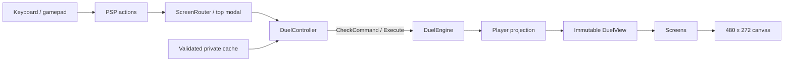

# Initial presentation

## Stack and boundaries

Use C#/.NET 10 and pinned `MonoGame.Framework.DesktopGL` 3.8.6 for the native
Windows application. MonoGame owns the window, game loop, GPU sprites, logical
render target, keyboard and gamepad. DesktopGL is the established SDL/OpenGL
backend; no emulator, Docker or research tools are runtime dependencies.
The [MonoGame release](https://monogame.net/blog/2026-10-26-3.8.6-release-2026/)
documents the distinction from its newer DesktopGL4 backend. Avalonia can be
considered for separate tooling; it is not a second game renderer. The private asset diagnostic screen reports presentation cache status without expanding gameplay support.

The controller owns Core's `DuelActionSource`, shared by human and AI clients.
The adapter generates candidates from the acting player's own cards and public zone addresses, checks them with Core's read-only
`CheckCommand`, and stores revision-bound command tokens. Confirmation calls
`DuelEngine.Execute`; there are no presentation writes to `DuelState`. Core checks
use a fork sharing immutable configuration/snapshots and replace only the fork's
state. Keep this invariant if engine storage changes. Queries and commands run
on the owning game thread.

Screens receive immutable `DuelView`/`PlayerView` snapshots and choice labels;
they receive neither raw engine state nor raw events. Opponent hands and set
cards contain no instance ID, card ID, description or statistics. Draw piles and
face-down Extra Decks expose counts only. Public cards and the viewer's own hand
and set cards expose identities. Pending choices are shown only to their owner;
opponent action messages never reuse labels containing private hand names.



## Folder ownership

| Path | Responsibility |
| --- | --- |
| `PC/Game/` | Host options, native game loop, navigation, deck/cache gate |
| `PC/App/` | Screen lifecycle/modal focus, PSP input, validated sprites/layouts and presentation events |
| `PC/UI/Gum/` | Editable reference-size layouts; Title/Menu/Options retained at runtime, remaining bindings and source measurements pending |
| `PC/Setup/` | Native first launch, private preferences, import/resume and recovery |
| `PC/Rendering/` | Viewport, ordered sprite layers, atlas regions, fallback text |
| `PC/Screens/` | Duel rendering from player views; application navigation binds screen handlers |
| `PC/DuelUI/` | Human/AI session controller, choices and `Input/` |
| `Core/Views/` | Shared authorized projections and revision-bound action adapter |
| `AI/` | Seeded policy, bounded opponent driver and replay contracts |
| `PC/Decks/` | Existing versioned deck persistence and validated selections |
| `PC/Import/` | Existing private cache creation/validation; retained API path |
| `Assets/GameSource/` | Trusted input profiles, ISO validation and source provenance |
| `PC/App/Visual/` | Explicit atlas regions, pending/measured layouts, shared texture ownership, deterministic animation and queued audio cues; original audio playback pending |
| `Core/` | Deterministic state, commands, rules and events |
| `Effects/` | Explicit supported card profiles and initial deck policy |
| `Tests/` | Synthetic portable contracts and opt-in private reference checks |

Use only the root solution. Future folders above describe planned ownership;
empty services and duplicate import APIs have not been added.

## Supported initial GUI

Title -> menu -> initial preview deck/order -> duel -> result -> deck selection.
Three 40-card orders (initial, reverse, attack first) use the 14-ID supported pool
and explicit authored collection; all pass the cache/policy/deck gate.
Ordered inputs and the [seeded opponent](../TagForceSpecial.AI/Contract.md) support
repeated runs, including engine-reported LP defeat and deck-out victory. Original
shuffle, character/tag AI, saves and story decks remain separate. No original
data is required for the title/menu window.

The duel shows hand/monster/back-row layouts, deck/Graveyard/Extra counts,
Pendulum slots, LP, phases, card descriptions, selection highlights and
authorized decisions/chain passing/resolution. Arrow/D-pad up/down selects an
action; left/right pages four actions; Enter/A confirms; Tab/Y inspects visible
cards; Escape/B pauses/resumes the duel. The pause menu can resume or end it;
returning to deck selection starts a new
duel. Supported preview actions include draws, normal summons, sets, position
changes, ordinary attacks, six normal spells, phase/turn progression and hand
limit discards. Other summon procedures and response effects need dedicated UI
selection workflows before being offered in this host.

The offscreen target is always 480 x 272. Point sampling presents it in a centered
aspect-preserving viewport with black letterboxes. `--pixel-exact` starts at 1x,
uses integer scaling when it fits, and freezes selection animation; smaller
windows downscale. Pointer-coordinate mapping rejects the letterboxes, although
mouse interaction is not yet wired. Visual time does not affect command results.
Layers order background, field, card sprites, text, cursor and future modal UI.
The authored ASCII font, rectangles and slot anchors are fallback presentation,
not a reconstructed PSP font, artwork or verified screen layout.

## Acceptance gates and next work

| Area | Current evidence | Remaining gate |
| --- | --- | --- |
| Research | Retained PSP captures can be indexed with input/timestamp/hash provenance; local screen/state and interaction inventory | Verify frame buffers and state preconditions, fresh same-build captures/video, deck selection/results/transitions and original controls |
| Importer | The build manifest validates the pinned source and reproducible catalog/raw-cardh cache; each source/output is mapped | Decode supported textures/card artwork/fonts/audio/dialogue into a versioned private manifest; resource samples and missing-format diagnostics |
| Foundation | Native window, canvas/scaling, layers/atlas-region API, fallback text, retained logical screenshots | Original static screen reproduction, imported font/atlases, timed effects, approved regions/tolerances and Windows resize comparison |
| Duel UI | Command controller, hidden-information views, legal choices, deterministic terminal preview | Original spatial navigation/prompt fidelity, deck/Graveyard inspection, dedicated advanced choices, original transition timing and manual controller acceptance |

For authored static captures at a fixed revision in pixel-exact mode, require
zero changed pixels on the same renderer/build. This verifies determinism only.
Original screenshot comparisons must use inspected active buffers, state/phase,
matching font/assets and explicit masks/tolerances. None has passed yet; do not
assign an arbitrary error tolerance to declare PSP visual parity.

Keep the original ISO, private assets, decoded catalogs, captures and saves out
of public source, CI inputs and packages. Extend trusted build/conversion
manifests for supported formats rather than trusting a cache's own checksums.
Full PSP fidelity remains separate; this initial GUI does not declare its
requirements complete.

## Run and verify

```powershell
dotnet restore ygo-tag-force-special-decomp.slnx --locked-mode
dotnet build ygo-tag-force-special-decomp.slnx --no-restore
dotnet run --project TagForceSpecial.PC --no-build -- --cache <private-cache>
dotnet run --project TagForceSpecial.PC --no-build -- --cache <private-cache> --pixel-exact --smoke --capture <new.png>
dotnet test TagForceSpecial.Tests --filter FullyQualifiedName~PresentationTests
```

`--capture` writes a new 480 x 272 PNG of the first frame and exits unless smoke
is running. It never overwrites a file. `--smoke` runs the real window plus both
players' command paths with a bounded command budget, reports a terminal outcome
and exits; failure to progress throws. It exercises rendering and commands,
not human keyboard/gamepad interaction. Private input setup commands remain in
the local setup notes; the GUI no longer requires research setup commands.
